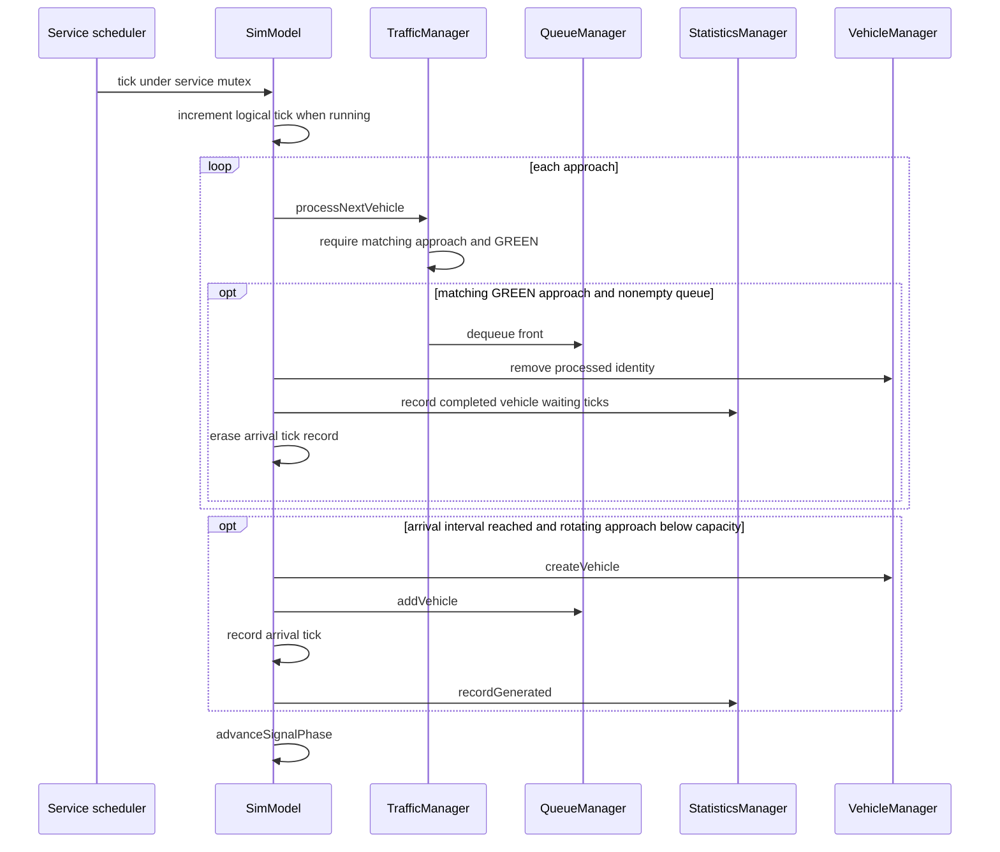
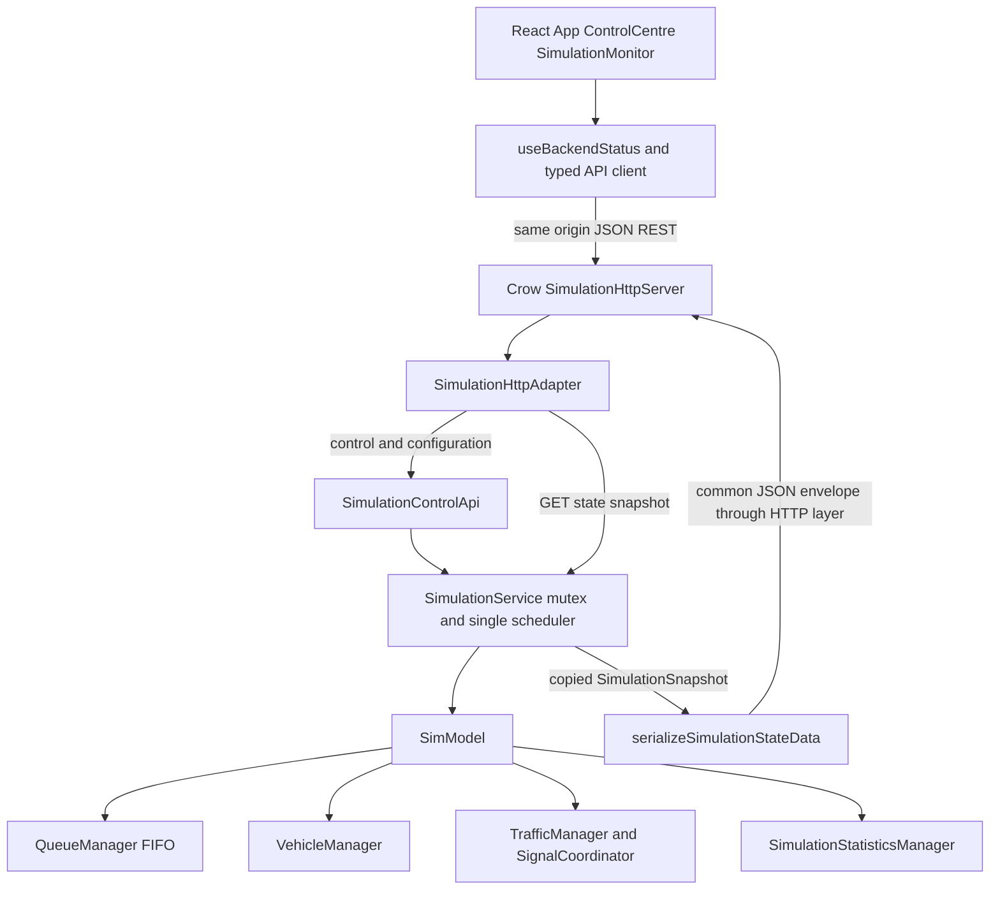
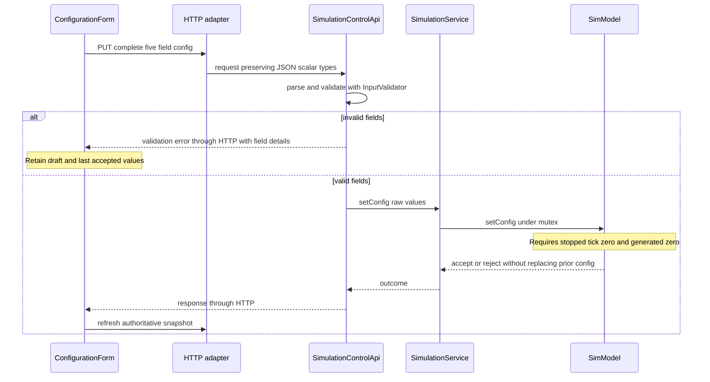
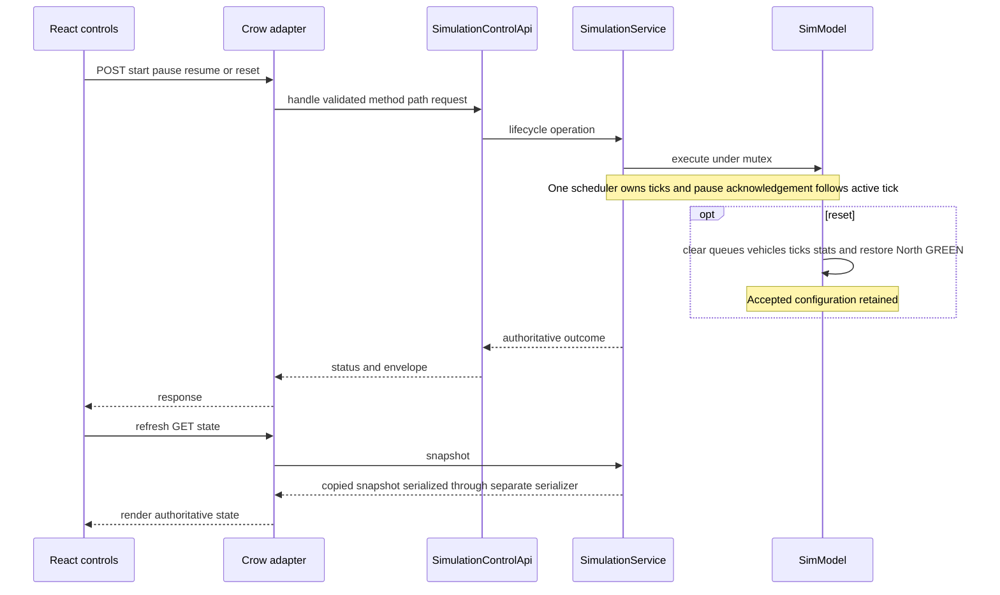

# Software Architecture and Design Specification

## Document control

Traffic Management System (Simulation), final submission revision 1.5, 19 November 2026. This document describes the actual web application and its C++ simulation ownership, interfaces and concurrency.

| Version | Date | Recorded contribution |
|---|---|---|
| 1.0 | 6 Oct 2026 | Daruvuri Pranav Sai, initial baseline |
| 1.1 | 6 Oct 2026 | GOWTHAM S, testing/security contribution |
| 1.2 | 6 Oct 2026 | Dinesh, architecture and module contribution |
| 1.3 | 6 Oct 2026 | C NITISH, design/GUI and traceability contribution |
| 1.4 | 19 Nov 2026 | Final submission reconciliation against implemented source and recorded audit evidence. Formal team/instructor sign-off pending. |
| 1.5 | 19 Nov 2026 | Applied the team-approved retrospective Sprint 3 documentation classification; preserved original sprint assignments, requirements, diagrams, testing evidence and limitations. No historical formal planning or instructor approval verified. |

The 1.0–1.3 rows reproduce the historical document revision records. They do not independently prove individual authorship of every document edit. Original documents and their complete wording are retained under docs/history/final-reconciliation-2026-11-19/. GitHub implementation authorship is described separately in the sprint change log.

## 1 Purpose scope and architectural goals

Separate presentation, transport, application coordination and simulation modules. Preserve deterministic logical rules and FIFO behavior while supporting concurrent HTTP requests. Historical desktop diagrams and conceptual interfaces remain in the original v1.3 records. Final diagrams are versioned under diagrams/final-submission/.

## 2 Runtime architecture

React App uses one useBackendStatus hook and a typed API client. ControlCentre and SimulationMonitor share authoritative state, controls and error feedback. Hash navigation selects pages without introducing a second simulation. Browser requests use same-origin /api URLs through the development Vite proxy. Crow registers routes through SimulationHttpAdapter. Control/config requests call SimulationControlApi. The GET snapshot path uses the same SimulationService and separate serializer. SimulationService owns SimModel and its single scheduler thread. SimModel coordinates vehicles, queues, signals, traffic processing and statistics.

| Component | Actual source | Responsibility |
|---|---|---|
| Browser shell and pages | frontend/src/App.tsx, components/ControlCentre.tsx, SimulationMonitor.tsx | Navigation, controls, metrics, junction/FIFO and detected activity |
| State hook/client | frontend/src/hooks/useBackendStatus.ts, api/client.ts | Requests, polling, pending/error/config state |
| Host entry and server | src/api_server_main.cpp, simulation_http_server.cpp | Construct shared service, bind/listen, worker and shutdown ownership |
| HTTP adapter/response | src/simulation_http_adapter.cpp, simulation_http_response.cpp | Method/path/body/envelope and origin/error boundary |
| Control API | src/simulation_control_api.cpp | Translate commands/config to service outcomes |
| Serializer | src/simulation_state_serializer.cpp | Serialize copied SimulationSnapshot with nlohmann-json |
| Service | src/simulation_service.cpp | One scheduler, mutex, lifecycle, snapshots and configuration |
| Model | src/simulation_model.cpp | Logical tick, rotating arrivals, signal phase and reset coordination |
| Queue and vehicles | src/queue_manager.cpp, vehicle_manager.cpp, vehicle.cpp | FIFO storage, identities and queue snapshots |
| Signals and traffic | src/TrafficSignal.cpp, TrafficManager.cpp | Legal phases, no conflicting GREEN, permitted front dequeue |
| Statistics | src/simulation_statistics_manager.cpp | Generated/processed/waiting totals and completed-vehicle waiting ticks |
| Validation/config | src/input_validator.cpp, config_controller.cpp, include/sim_config.h | Canonical ranges, parsing and accepted-state protection |

## 3 Interfaces data and deployment

| Method | Path | Actual responsibility |
|---|---|---|
| GET | /api/simulation/state | Consistent state/config/queues/statistics snapshot |
| POST | /api/simulation/start | Start stopped simulation |
| POST | /api/simulation/pause | Pause running simulation |
| POST | /api/simulation/resume | Resume paused simulation |
| POST | /api/simulation/reset | Stop, clear activity, retain configuration |
| PUT | /api/simulation/config | Apply complete validated configuration before activity |

The normal response envelope contains success, data and error. Invalid configuration returns validation details and preserves accepted values. Invalid lifecycle transitions return conflicts. Malformed/oversized requests and unsupported routes/methods are rejected. Actual error codes and body schemas are documented in docs/REST_API.md and Simulation_Control_API_Contract.md.

Data flows as copied SimulationSnapshot DTOs, including state, tickCount, config, four approaches/vehicles and aggregate/per-approach statistics. Storage is in memory. No database/schema exists. The road scene positions markers by queue order for display, without claiming backend movement coordinates. The bounded client activity list derives differences between snapshots.

Production guidance uses one browser/API origin through a reverse proxy. Default local binding is loopback. TMS_HTTP_BIND_ADDRESS can explicitly alter binding. Host/origin validation and request-body limits are security boundaries, not authentication. TLS/authentication are not built in. The API server remains stopped at simulation level until a Start command.

## 4 Scheduling synchronization and lifecycle

SimulationService owns one scheduler thread and serializes ticks, reads, lifecycle changes and configuration with a mutex. A condition variable coordinates waiting/interruption. Pause acknowledgement follows any in-progress tick. Snapshots copy state under the service boundary. HTTP concurrency does not create extra simulation clocks. Shutdown stops/joins the HTTP host before the service is destroyed. Service lifetime must exceed host lifetime. Defensive exception paths stop scheduling or return generic errors as appropriate.

SimModel::tick processes only allowed queues, records waiting ticks for departures, creates one rotating approach arrival when due/capacity permits, and advances the active signal phase. TrafficManager checks approach identity and GREEN before FIFO removal. SignalCoordinator allows RED→GREEN→YELLOW→RED and refuses GREEN while another approach is non-RED. Reset dequeues/removes vehicles, clears tick/arrival/statistics state and returns stopped/North GREEN while retaining config. Average waiting uses completed vehicles. Processed per tick is cumulative.

## 5 Component and sequence diagrams

Final component diagram and three concrete sequences are in diagrams/final-submission/component.mmd, arrival-processing.mmd, lifecycle.mmd and configuration.mmd. The source diagrams are embedded below in the Markdown edition. They replace conflicting desktop runtime assumptions for this revision. Historical diagram files remain untouched.

## 6 Build dependency boundaries and tests

CMake tms_core is independent of Crow and nlohmann-json. API-enabled targets add the HTTP layer and serializer. BUILD_API_SERVER=OFF omits those dependencies. Qt remains archived under legacy/qt-prototype and is not an active build dependency. The gui_model compatibility name is historical. Frontend dependencies use package-lock.json. Pinned HTTP dependencies and Crow patch are recorded in CMakeLists.txt and docs/REST_API.md. CTest, Vitest and real-backend Playwright cover the modules and interfaces with the evidence limits described in the Test Plan.

## 7 Evolution and residual risks

The C++ desktop GUI concept evolved into a React frontend, Crow REST API and C++ SimulationService architecture. The model, FIFO queues, signal rules, validation and statistics were retained; service ownership, one synchronized scheduler, copied-state serialization and browser polling became explicit boundaries. The team approved the label Sprint 3 — Web Migration (Retrospective Classification) on 19 November 2026 for issues #26–35, with an observed 4–14 November 2026 IST window. This grouping adds 44 points to the original 47 without reassigning original stories. Issue #9 supplied host integration and later PR #53 supplied the two-page GUI. Formal historical Sprint 3 planning, original iteration assignment and instructor approval remain unverified.

Continuous traffic trajectories, event streaming and countdowns remain unavailable. Target-device performance and comprehensive memory/concurrency proofs are not claimed. See the final evidence ledger and sprint change log.

Backlog scope increased by 44 story points; a historical rise in the burndown chart has not been independently verified.

Reconciled 19 November 2026 for the 20 November 2026 viva. Source baseline 5cbdc012591221ccf300a9656b55bb1c5c38a2d2, branch feature/professional-traffic-ui, plus the seven existing uncommitted frontend redesign files. This documentation change does not commit or approve the redesign. Execution results below belong to the 19 November audit working tree. Historical results retain their original dates and revisions. No new execution is implied by this reconciliation.

### Arrival Processing

### Component

### Configuration

### Lifecycle

